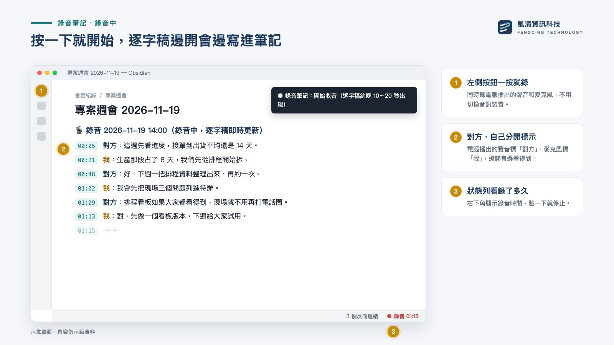
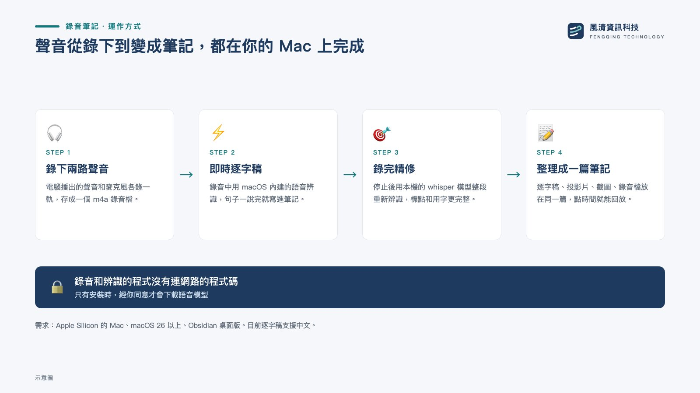

# Obsidian 錄音筆記（Meeting Recorder）

Record online meetings and classes from inside Obsidian on macOS: system audio + microphone in one click, live transcript while recording, a whisper re-transcription afterwards, and screenshots/slides placed on the transcript timeline. Speech and text recognition run on your Mac.
Apple Silicon, macOS 26+. Detailed docs are in Traditional Chinese. **[English summary and disclosures](#english-summary)** are at the end of this page.


在 Obsidian 按一顆按鈕，同時錄下**電腦播出的聲音**和**麥克風**，逐字稿、截圖、投影片都收進同一篇筆記。線上會議、課程、訓練都能用。免費、開放原始碼。

**先確認這三件事，再決定要不要裝：**

- 只能在 **Apple Silicon 的 Mac** 上用，macOS 26 以上，Obsidian 桌面版。
- 逐字稿目前**只支援中文**。
- 除了裝外掛，還要在終端機**執行一次安裝腳本**，過程會下載 1.6 GB 的語音模型。

## 它幫你做什麼

- **開會時不用忙著打字。** 錄音進行中就有逐字稿，分成「對方」（電腦播出的聲音）和「我」（麥克風）。
- **錄完得到比較準的版本。** 停止後用 whisper 模型整段重新辨識，取代即時版。
- **截圖和投影片對得上當時講的話。** 錄音中貼進筆記的截圖自動排到對應的時間，圖裡的字會辨識出來；也可以同時錄某個 App 的畫面，換頁時自動截投影片。
- **要找哪一句，點一下就到。** 點逐字稿的時間，從那一句開始播放。
- **聲音留在你的 Mac。** 語音辨識用 macOS 內建功能與本機的 whisper 模型，文字辨識用 macOS 內建的 Vision。錄音與辨識的程式沒有連網路的程式碼；只有安裝腳本在你同意時會下載模型。

## 使用情境

以下畫面都是示意，內容為示範資料。

### 線上會議：邊開邊有逐字稿

用 Teams 這類線上會議開會時，按一下左側按鈕就開始錄。它錄的是電腦播出的聲音，不挑會議軟體；實際測過的是 Teams。對方說的話和你說的話分開標示，會議還沒結束，筆記裡已經有大半的紀錄。



### 教育訓練、簡報說明：投影片對上講到的地方

同時錄簡報那個 App 的畫面，換頁時自動截圖，排到講到那一頁的時間。錄完用 whisper 整段重新辨識，複習時點時間就從那一句開始聽。


### 需要顧慮隱私的訪談

聲音只在你的 Mac 上處理：即時逐字稿用 macOS 內建的語音辨識，精修用本機的 whisper 模型。錄音與辨識的程式沒有連網路的程式碼。



### 搭配 AnnotateScreen：畫好的重點自動收進筆記

[AnnotateScreen](https://github.com/FengQing-TW/annotate-screen) 是我們另一個螢幕標註工具。分享螢幕時用它在畫面上畫重點，按 ⌃⌥S 截圖，截圖會自動收進目前的筆記；錄音中的截圖會排進逐字稿，對上截圖的那一秒。


## 安裝

### 1. 準備環境

- Apple Silicon 的 Mac，macOS 26 以上。開發與實際使用都在 macOS 27，26 是依用到的系統功能推估，沒有實測
- Obsidian 桌面版
- Command Line Tools（在終端機執行 `xcode-select --install`）
- [Homebrew](https://brew.sh)。安裝腳本會用它裝 `whisper-cpp`、`opencc`、`ffmpeg`，裝之前會先問你
- 約 1.6 GB 的空間放 whisper 模型 `ggml-large-v3-turbo.bin`，下載之前也會先問你

### 2. 執行安裝腳本

```zsh
git clone https://github.com/FengQing-TW/obsidian-meeting-recorder.git
cd obsidian-meeting-recorder
zsh install.sh
```

腳本會依序做這些事：

1. 檢查環境，問你要不要用 Homebrew 裝缺的套件
2. 把錄音程式放到 `~/.config/course-recorder/`，並在本機編譯
3. 問你要不要下載模型
4. 把外掛裝進你指定的 vault（Obsidian 的筆記資料夾）。已經從社群外掛目錄裝過外掛的話，這一步可以跳過

可以重複執行，既有的檔案會先備份。不會用到 sudo。

### 3. 重新啟動 Obsidian 並允許權限

裝完重新啟動 Obsidian，左側會出現麥克風按鈕。第一次使用要依序允許 Obsidian 的麥克風、系統錄音、語音辨識權限；要錄 App 畫面再允許螢幕錄製。

### 也可以從 Obsidian 社群外掛目錄安裝外掛

外掛已上架 [Obsidian 社群外掛目錄](https://community.obsidian.md/plugins/meeting-recorder)，可以在 Obsidian 的「設定 → 第三方外掛」搜尋 Meeting Recorder 安裝。

**不管從哪裡裝外掛，都要在終端機執行一次 `install.sh`。** 它會在本機編譯錄音程式，外掛靠這支程式錄音；沒有它，按錄音會顯示找不到錄音程式。

## 開始錄音

1. 打開要放逐字稿的筆記，按左側的麥克風按鈕，選「只錄音」或「錄音＋錄 App 畫面…」。選了之後才開始錄。錄 App 畫面時，AnnotateScreen 畫的標註會一起錄進去（工具列不會）。
2. 照常開會、照常在筆記裡打字。逐字稿會一段一段寫進筆記。
3. 再按一次同一顆按鈕停止。背景會用 whisper 整段重新辨識，完成後取代即時版。

完整用法、設定、出狀況時的行為，見 [docs/使用說明.md](docs/使用說明.md)。

建議戴耳機使用。測試都是戴耳機做的，用喇叭播放的情況沒有測過。

## 錄音前請先告知對方

這個工具會錄下電腦播出的所有聲音，包括會議裡其他人的聲音。用在會議或課程時，請先讓對方知道，並遵守主辦方、所在單位與當地法律的規定。怎麼使用由你自己負責。

## 它會動到哪些地方

- **vault 以外的檔案：** 外掛會執行放在 `~/.config/course-recorder/` 的錄音程式和腳本，逐字稿完成前的暫存錄音也放在這裡。畫面錄影存到 `~/Downloads/螢幕錄影/`（介面是英文時為 `~/Downloads/Screen Recordings/`）。外掛會留意 `~/Downloads` 裡 AnnotateScreen 的截圖，把它收進筆記。
- **網路：** 外掛和錄音程式不發出網路請求。語音與文字辨識用 macOS 內建功能和本機的 whisper 模型。只有 `install.sh` 會連網路，而且是在你同意之後：用 Homebrew 裝套件、從 Hugging Face 下載 1.6 GB 的 whisper 模型。macOS 第一次使用語音辨識時，可能會自己下載系統的辨識資料。
- **帳號與費用：** 不用註冊帳號，不收費，沒有廣告，不蒐集使用資料。
- **介面語言：** 預設跟著 Obsidian。要固定語言，在外掛的 `data.json` 加上 `"lang": "zh"` 或 `"lang": "en"`。

## 已知限制

- 一小時以上的錄音還沒有實測過，目前最長的實錄是 30 分鐘
- 錄音程式被強制結束或電腦斷電時，錄音檔可能無法播放
- 進行中的即時逐字稿，英文術語常聽錯；錄完重新辨識後會改善，但仍可能出錯
- 對方有好幾個人時，不會分辨是誰講的
- 錄畫面時不要選 Obsidian 自己的視窗，逐字稿每出一行都會被當成換頁
- 藍牙耳機從聽音樂切到通話模式要 4 到 10 秒，這段時間的聲音錄不到
- 用藍牙耳機的麥克風時，電腦的聲音也會降成通話音質，講話聽得清楚，音樂比較悶

## 支援

這是自用工具，照現況提供，不保證回覆問題或修正。

覺得好用的話，歡迎在 [Ko-fi](https://ko-fi.com/fengqingtech) 請我們喝杯咖啡，支持後續維護。

## 授權

MIT，見 [LICENSE](LICENSE)。相依的 whisper.cpp、OpenCC、ffmpeg 由你自己用 Homebrew 安裝，各有各的授權條款。

## English summary

**Before you install**

- **macOS only, Apple Silicon, macOS 26 or later.** The plugin is desktop-only.
- **The plugin needs a separate one-time setup.** Installing the plugin alone is not enough: run `zsh install.sh` from this repository in Terminal. It compiles a small Swift recorder on your Mac and places it in `~/.config/course-recorder/`. Without it the record button shows "recorder not found".
- **Transcription currently supports Mandarin Chinese only** (live transcript and whisper refinement). The interface follows Obsidian's language (Chinese or English).
- **Please tell other participants before you record.** It records everything your Mac plays, including other people in a meeting. Follow your organizer's rules and local law.

**Disclosures (as required by the Obsidian developer policies)**

- **Files outside your vault:** the plugin runs the recorder and scripts in `~/.config/course-recorder/`, keeps temporary audio there until a transcript is finished, saves screen recordings to `~/Downloads/Screen Recordings/` (or `~/Downloads/螢幕錄影/` with the Chinese interface), and watches `~/Downloads` for AnnotateScreen screenshots to import.
- **Network use:** the plugin and the recorder make no network requests. Speech and text recognition use the macOS built-in recognizers and a local whisper model. Only `install.sh` uses the network, and only after you confirm: Homebrew packages and the 1.6 GB whisper model from Hugging Face. macOS may download its own speech recognition assets the first time.
- **No account, no payment, no ads, no telemetry.** The plugin is free. If it saves you time, you can support its maintenance on [Ko-fi](https://ko-fi.com/fengqingtech).

**Settings:** to force the interface language, add `"lang": "en"` or `"lang": "zh"` to the plugin's `data.json` (default `"auto"` follows Obsidian).
